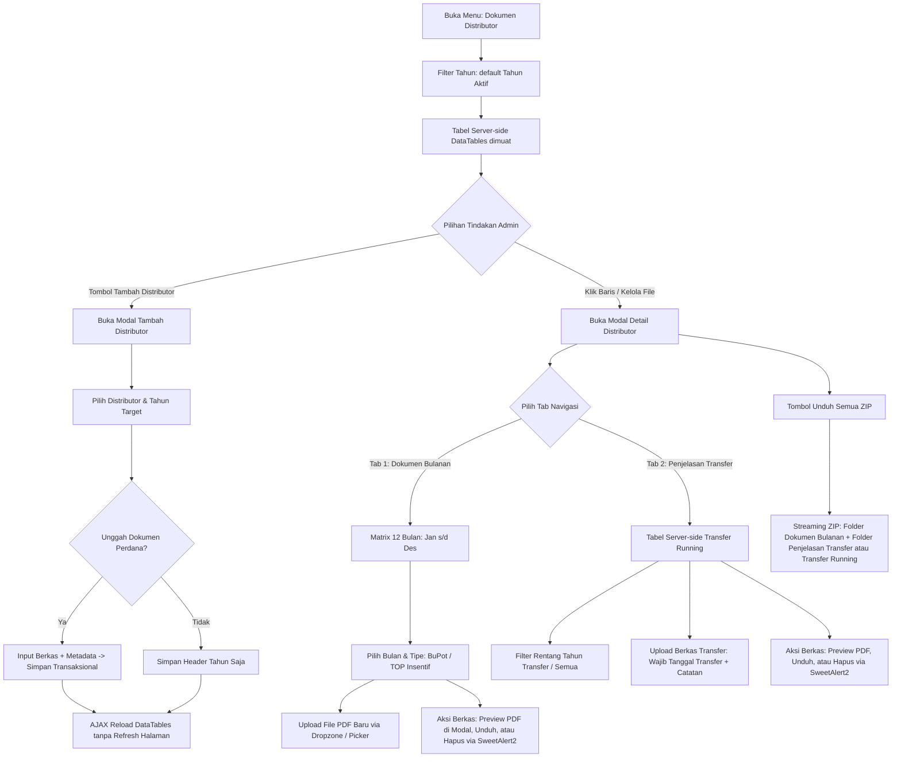
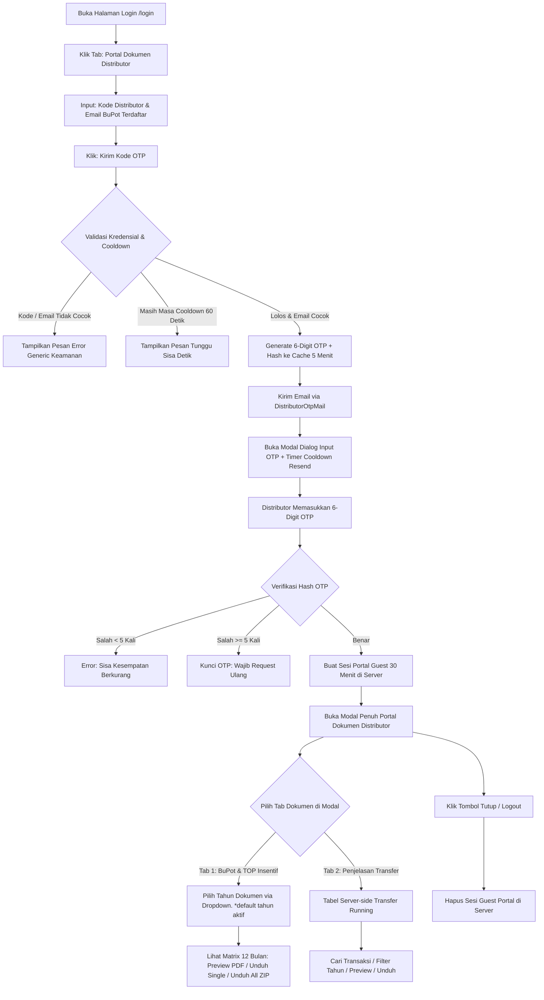
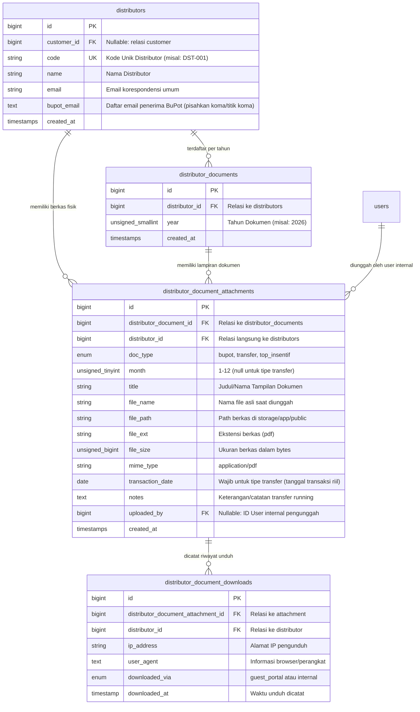

# 📘 Dokumentasi Implementasi Sistem Pengelolaan & Portal Dokumen Distributor

Dokumen ini merupakan spesifikasi implementasi teknis (*as-built documentation*) dari fitur **Pengelolaan Dokumen Distributor (Bukti Potong, Penjelasan Transfer Running, dan TOP Insentif)** di sistem Finance. Dokumen ini merefleksikan seluruh perubahan arsitektur, skema basis data, alur pengguna (*User Flow*), serta kode backend dan antarmuka (*UI/UX*) yang telah diimplementasikan.

---

## 📑 Daftar Isi
1. [Ringkasan Sistem & Perubahan Utama (Changelog vs Spec Awal)](#1-ringkasan-sistem--perubahan-utama-changelog-vs-spec-awal)
2. [Klasifikasi & Karakteristik Tipe Dokumen](#2-klasifikasi--karakteristik-tipe-dokumen)
3. [Arsitektur Alur Pengguna (User Flow)](#3-arsitektur-alur-pengguna-user-flow)
   - [A. Sisi Internal Finance (Monitoring DataTables, Quick Add & Manajemen Dokumen)](#a-sisi-internal-finance-monitoring-datatables-quick-add--manajemen-dokumen)
   - [B. Sisi Eksternal Distributor (Portal Akses Mandiri Berbasis OTP Email)](#b-sisi-eksternal-distributor-portal-akses-mandiri-berbasis-otp-email)
4. [Rancangan Desain Antarmuka (UI/UX)](#4-rancangan-desain-antarmuka-uiux)
   - [A. Halaman Monitoring DataTables Internal](#a-halaman-monitoring-datatables-internal)
   - [B. Modal Detail Distributor (Matrix 12 Bulan vs Tab Transfer Running)](#b-modal-detail-distributor-matrix-12-bulan-vs-tab-transfer-running)
   - [C. Tab Portal Publik & Modal Verifikasi OTP di Halaman Login](#c-tab-portal-publik--modal-verifikasi-otp-di-halaman-login)
5. [Skema Basis Data (Database Schema & Migrations)](#5-skema-basis-data-database-schema--migrations)
6. [Arsitektur Kode & Domain Services](#6-arsitektur-kode--domain-services)
   - [A. Model Eloquent & Relasi](#a-model-eloquent--relasi)
   - [B. Domain Services (`DistributorDocumentService` & `DistributorPortalAuthService`)](#b-domain-services-distributordocumentservice--distributorportalauthservice)
   - [C. Form Requests](#c-form-requests)
   - [D. Mailable Notifikasi OTP (`DistributorOtpMail`)](#d-mailable-notifikasi-otp-distributorotpmail)
7. [Rancangan Routing & Controller](#7-rancangan-routing--controller)
8. [Keamanan, Audit Trail & Proteksi Sistem](#8-keamanan-audit-trail--proteksi-sistem)

---

## 1. Ringkasan Sistem & Perubahan Utama (Changelog vs Spec Awal)

Sistem ini melayani dua peran utama pengguna (*Dual Actors*):
1. **Tim Internal Finance / Tax / Sales Admin:**
   - Memantau kelengkapan dokumen pajak bulanan dan insentif seluruh distributor per tahun berjalan (Januari s/d Desember) via tabel server-side DataTables.
   - Mengelola berkas **Penjelasan Transfer** yang bersifat *running lintas tahun* (*multi-year running archive*) tanpa dibatasi siklus tahunan.
   - Menambahkan distributor ke dalam pantauan tahun berjalan secara instan (*Quick Add Modal*) tanpa harus berpindah ke modul Master.
   - Mengunggah berkas (PDF maksimal 1MB), pratinjau inline (*modal preview*), serta menghapus berkas secara asinkron (*AJAX + SweetAlert2*).
2. **Distributor (Portal Mandiri / Self-Service):**
   - Mengakses portal dokumen mandiri langsung dari tab di halaman `/login`.
   - Menggunakan verifikasi keamanan (**OTP 6 Digit via Email BuPot**) untuk mencegah pembobolan dokumen finansial oleh pihak ketiga.
   - Menelusuri Bukti Potong per tahun kalender, melihat berkas Penjelasan Transfer *running*, serta mengunduh paket seluruh berkas dalam bentuk `.ZIP`.

### 🔄 Perubahan Signifikan dari Rancangan Awal (*Delta / Improvements*)

| Aspek | Rancangan Awal (`README.md`) | Implementasi Terpasang (*Actual*) |
| :--- | :--- | :--- |
| **Autentikasi Portal Publik** | Distributor langsung mengakses hanya dengan menginput Kode Distributor dan memilih Tahun di form login. | **Autentikasi dengan OTP Email**: Distributor memasukkan Kode & Email BuPot terdaftar -> sistem mengirim 6-digit OTP ke email -> verifikasi OTP berhasil -> sesi portal guest dibuka selama 30 menit. Pemilihan tahun dipindahkan ke dalam modal dokumen. |
| **Keamanan Rute Publik** | Rate limiter generic (`throttle:10,1`). | **Isolasi Rate Limiter per Endpoint**: `portal_otp` (5 req/m), `portal_verify` (10 req/m), `portal_docs` (120 req/m), `portal_preview` (60 req/m), `portal_download` (30 req/m), `portal_zip` (15 req/m). Ditambah *honeypot* anti-bot dan proteksi *brute force* (maksimal 5 kali salah). |
| **Arsitektur Backend** | Logika proses terkumpul di dalam controller. | **Domain Service Pattern**: Logika dipisahkan ke `DistributorDocumentService` (pengelolaan dokumen, DataTables, upload, hashing, ZIP) dan `DistributorPortalAuthService` (manajemen OTP, rate limit, hashing cache, dan sesi). Validasi dienkapsulasi menggunakan `FormRequest`. |
| **Tabel Monitoring Internal** | Render tabel blade statis. | **Server-Side DataTables (Yajra)** dengan partial komponen terpisah untuk badge kode, nama distributor (dengan kontak BuPot), progres 12 bulan (hijau/kuning/abu-abu), rentang tahun transfer running (misal: `2024-2026`), dan tombol aksi. |
| **Pendaftaran Distributor ke List** | Hanya manual lewat form master distributor. | **Modal Quick Add Distributor** (`add-distributor-modal.blade.php`) langsung dari halaman dokumen: mendukung pendaftaran ke tahun terpilih dan opsi unggah dokumen perdana secara transaksional dalam satu langkah. |
| **Penanganan Berkas Transfer** | Form upload generik. | Form upload dengan sanitasi otomatis: jika memilih jenis *Penjelasan Transfer*, input bulan (*month*) otomatis dikosongkan dan dinonaktifkan, sedangkan input tanggal transfer riil (*transaction_date*) menjadi wajib. |
| **Paket Download ZIP** | Nama file flat di dalam ZIP. | Nama file di dalam ZIP diberi suffix unik turunan hash MD5 timestamp (`generateRandomStringFromTimestamp`) untuk mencegah tabrakan nama berkas kembar. |
| **Struktur View Blade** | Di bawah folder `resources/views/finance/` | Disesuaikan dengan struktur baku proyek di `resources/views/page/distributor_documents/` dan `resources/views/auth/partials/`. |

---

## 2. Klasifikasi & Karakteristik Tipe Dokumen

| Tipe Dokumen | *Scope* Waktu | Batasan Jumlah (*Cardinality*) | Validasi & Karakteristik Bisnis |
| :--- | :---: | :---: | :--- |
| **Bukti Potong (`bupot`)** | **Per Tahun & Per Bulan (Jan - Des)** | Multi-file per bulan | Wajib mengisi `year` dan `month` (1-12). Terikat masa pajak bulanan (PPh 23, PPh 22, dsb). Format wajib PDF dengan ukuran maksimal 1MB (1024 KB). |
| **TOP Insentif (`top_insentif`)** | **Per Tahun & Per Bulan (Jan - Des)** | Multi-file per bulan | Wajib mengisi `year` dan `month` (1-12). Berisi memo persetujuan insentif, deviasi TOP, atau kompensasi penjualan. Format wajib PDF dengan ukuran maksimal 1MB. |
| **Penjelasan Transfer (`transfer`)** | **Per Distributor (Running Multi-Year / Sejak Arsip s/d Sekarang)** | Multi-file (Running terus tanpa batas tahun) | **TIDAK TERIKAT masa kalender bulanan.** Input `month` dilarang (*prohibited/null*), sedangkan `transaction_date` wajib diisi. Menjadi repositori riwayat transfer running distributor. Format wajib PDF maksimal 1MB. |

---

## 3. Arsitektur Alur Pengguna (User Flow)

### A. Sisi Internal Finance (Monitoring DataTables, Quick Add & Manajemen Dokumen)



### B. Sisi Eksternal Distributor (Portal Akses Mandiri Berbasis OTP Email)



---

## 4. Rancangan Desain Antarmuka (UI/UX)

### A. Halaman Monitoring DataTables Internal
Halaman utama di `page/distributor_documents/index.blade.php` menyajikan tabel data server-side dengan filter tahun aktif dan aksi cepat penambahan distributor:

```text
========================================================================================================
📋 MANAJEMEN DOKUMEN DISTRIBUTOR                              [ Filter Tahun: 2026 v ] [ + Tambah Distributor ]
========================================================================================================
Pencarian: [ Cari kode, nama distributor... ]
--------------------------------------------------------------------------------------------------------
KODE     | NAMA DISTRIBUTOR                 | PROGRES BULANAN 2026 (JAN - DES)        | TRF RUNNING | AKSI
--------------------------------------------------------------------------------------------------------
DST-001  | PT Sinar Abadi Jaya              | [1][2][3][4][5][6][7][8][9][10][11][12] | 8 File      | [ 📂 Kelola ]
         | 📧 bupot@sinarabadi.co.id        |  🟩 🟩 🟩 🟩 🟨 ⬜ ⬜ ⬜ ⬜  ⬜  ⬜  ⬜   | (2020-2026) |
DST-002  | CV Maju Perkasa                  |  🟩 🟩 ⬜ ⬜ ⬜ ⬜ ⬜ ⬜ ⬜  ⬜  ⬜  ⬜   | 3 File      | [ 📂 Kelola ]
         | 📧 finance@majuperkasa.com       |                                         | (2024-2026) |
DST-003  | PT Sumber Berkat Abadi           |  ⬜ ⬜ ⬜ ⬜ ⬜ ⬜ ⬜ ⬜ ⬜  ⬜  ⬜  ⬜   | 0 File      | [ 📂 Kelola ]
         | ⚠️ Belum ada email BuPot         |                                         | (-)         |
--------------------------------------------------------------------------------------------------------
Keterangan Badge: 🟩 Lengkap (BuPot & TOP ada) | 🟨 Sebagian terisi | ⬜ Kosong
```

### B. Modal Detail Distributor (Matrix 12 Bulan vs Tab Transfer Running)
Pengelolaan dokumen dibuka melalui modal AJAX (`detail-content.blade.php`) tanpa memicu perpindahan URL:

```text
+----------------------------------------------------------------------------------------------------+
| 🏢 PT Sinar Abadi Jaya (DST-001)                                              [ 💾 Download All .ZIP ]
| NPWP: 01.234.567.8-901.000 | Email BuPot: bupot@sinarabadi.co.id
+----------------------------------------------------------------------------------------------------+
|  [ TAB 1: Dokumen Bulanan (BuPot & TOP Insentif) ]  |  [ TAB 2: Penjelasan Transfer (Running) ]    |
+----------------------------------------------------------------------------------------------------+

=== JIKA MEMILIH TAB 1: DOKUMEN BULANAN ===
Filter Tahun Dokumen: [ 2026 v ]

[ 📅 JANUARI 2026 ] 🟩 3 Dokumen                     [ 📅 FEBRUARI 2026 ] 🟨 1 Dokumen
+--------------------------------------------------+ +--------------------------------------------------+
| 🧾 Bukti Potong (2 File):                        | | 🧾 Bukti Potong (1 File):                        |
|   • Bupot_PPh23_Jan.pdf  (420 KB)                | |   • Bupot_PPh23_Feb.pdf (380 KB)                 |
|     [ 👁️ Preview ] [ ⬇️ Unduh ] [ 🗑️ Hapus ]        |     [ 👁️ Preview ] [ ⬇️ Unduh ] [ 🗑️ Hapus ]        |
|   • Bupot_PPN_Jan.pdf    (310 KB)                | |   [ + Tambah BuPot ]                             |
|     [ 👁️ Preview ] [ ⬇️ Unduh ] [ 🗑️ Hapus ]        | |                                                  |
|   [ + Tambah BuPot ]                             | | 🎯 TOP Insentif (0 File):                        |
|                                                  | |   +--------------------------------------------+ |
| 🎯 TOP Insentif (1 File):                        | |   | ☁️ Klik / Drop file TOP Insentif Feb di sini| |
|   • Memo_Insentif_Jan.pdf (180 KB)               | |   +--------------------------------------------+ |
|     [ 👁️ Preview ] [ ⬇️ Unduh ] [ 🗑️ Hapus ]        | |                                                  |
+--------------------------------------------------+ +--------------------------------------------------+

=== JIKA MEMILIH TAB 2: PENJELASAN TRANSFER RUNNING ===
[ + Upload File Transfer Baru ]  [ Filter Rentang Tahun: Semua Tahun v ]  [ Cari berkas transfer... ]

--------------------------------------------------------------------------------------------------------
TANGGAL / TAHUN | NAMA FILE / JUDUL          | CATATAN TRANSAKSI                      | UKURAN | AKSI
--------------------------------------------------------------------------------------------------------
15 Jan 2026     | Trf_Pelunasan_Jan2026.pdf  | Transfer pelunasan invoice INV-2026-01 | 350 KB | [👁️] [⬇️] [🗑️]
10 Nov 2025     | Rekonsiliasi_Q4_2025.pdf   | Bukti potong & kompensasi retur        | 920 KB | [👁️] [⬇️] [🗑️]
05 Mar 2023     | Transfer_Kompensasi.pdf    | Dokumen penyesuaian transfer cabang    | 280 KB | [👁️] [⬇️] [🗑️]
12 Agu 2020     | Arsip_Awal_Kerjasama.pdf   | Berkas transfer awal kerja sama        | 520 KB | [👁️] [⬇️] [🗑️]
--------------------------------------------------------------------------------------------------------
```

### C. Tab Portal Publik & Modal Verifikasi OTP di Halaman Login

```text
+---------------------------------------------------------------------------------+
|                           CUSTOMER PORTAL FINANCE                               |
+---------------------------------------------------------------------------------+
|  [ 👤 Login Karyawan (NIK) ]    |    [ 📜 Portal Dokumen Distributor ]          | <-- Aktif
+---------------------------------------------------------------------------------+
| Akses Mandiri Dokumen Pajak, Transfer & Insentif Distributor                   |
|                                                                                 |
| Kode Distributor *                                                              |
| [ DST-001                                                          ]            |
|                                                                                 |
| Email BuPot Terdaftar *                                                         |
| [ bupot@sinarabadi.co.id                                           ]            |
|                                                                                 |
| [ 📨 Kirim Kode OTP ]                                                           |
+---------------------------------------------------------------------------------+

                      || (Setelah tombol diklik & email cocok)
                      \/
+---------------------------------------------------------------------------------+
| 🔐 VERIFIKASI KODE OTP                                                          |
+---------------------------------------------------------------------------------+
| Kode OTP 6-digit telah dikirim ke email b***t@sinarabadi.co.id.                 |
|                                                                                 |
| Masukkan Kode OTP:                                                              |
| [ _ _ _ _ _ _ ]  (Contoh: 849201)                                               |
|                                                                                 |
| [ ✅ Verifikasi & Masuk Portal ]                                                |
| Tidak menerima email? Kirim ulang dalam (48s)                                   |
+---------------------------------------------------------------------------------+

                      || (Setelah OTP lolos verifikasi)
                      \/
+---------------------------------------------------------------------------------+
| 🏢 PT Sinar Abadi Jaya (DST-001)                         [ 🚪 Tutup / Keluar ]  |
+---------------------------------------------------------------------------------+
|  [ 🧾 Bukti Potong & TOP Insentif ]   |   [ 💸 Penjelasan Transfer Running ]    |
+---------------------------------------------------------------------------------+
|  Pilih Tahun Dokumen: [ 2026 v ]                          [ 📦 Unduh Semua ZIP ]|
|                                                                                 |
|  • Januari 2026:                                                                |
|    - Bukti Potong PPh 23 (420 KB)                     [ 👁️ Preview ] [ ⬇️ Unduh ]|
|    - Bukti Potong PPN (310 KB)                        [ 👁️ Preview ] [ ⬇️ Unduh ]|
|    - TOP Insentif Januari (180 KB)                    [ 👁️ Preview ] [ ⬇️ Unduh ]|
+---------------------------------------------------------------------------------+
```

---

## 5. Skema Basis Data (Database Schema & Migrations)

### Diagram Relasi Entitas (ERD)



### Rincian Migrasi Basis Data Terkait

1. **`2026_10_02_111042_create_distributor_documents_table.php`**
   - Membuat tabel header pendaftaran per tahun `distributor_documents`.
   - Mengunci keunikan kombinasi distributor dan tahun:
     ```php
     $table->unique(['distributor_id', 'year'], 'dist_doc_distributor_year_unique');
     ```

2. **`2026_10_02_111050_create_distributor_document_attachments_table.php`**
   - Menyimpan seluruh berkas fisik lampiran `distributor_document_attachments`.
   - Kolom `month` bertipe `unsignedTinyInteger` nullable (hanya untuk `bupot` dan `top_insentif`).
   - Kolom `transaction_date` dan `notes` untuk pencatatan berkas `transfer` *running*.
   - Dilengkapi composite index untuk kecepatan kueri:
     ```php
     $table->index(['distributor_document_id', 'doc_type', 'month'], 'dist_doc_att_period_idx');
     $table->index(['distributor_id', 'doc_type'], 'dist_doc_att_type_idx');
     $table->index(['distributor_id', 'doc_type', 'transaction_date'], 'dist_doc_att_trf_timeline_idx');
     ```

3. **`2026_10_02_111102_create_distributor_document_downloads_table.php`**
   - Mencatat jejak audit pengunduhan berkas fisik baik dari portal publik maupun internal tim finance.
   - Menggunakan `timestamp('downloaded_at')->useCurrent()`. Model diatur `$timestamps = false`.

4. **`2026_10_06_055507_add_bupot_email_to_distributors_table.php`**
   - Menambahkan kolom `text('bupot_email')->nullable()->after('email')` pada tabel `distributors` dan support multi-email bukti potong yang dipisahkan koma atau titik koma.

---

## 6. Arsitektur Kode & Domain Services

### A. Model Eloquent & Relasi

#### 1. `App\Models\Customer\Distributor`
- **Atribut & Accessor:**
  - `bupot_email_list`: Mengembalikan array email hasil parsing dari string `bupot_email` (memisahkan koma dan titik koma).
  - `email_list`: Mengembalikan array email umum korespondensi.
- **Relasi:**
  - `documents()`: `hasMany(DistributorDocument::class)`
  - `attachments()`: `hasMany(DistributorDocumentAttachment::class)`
  - `transferDocuments()`: `hasMany(DistributorDocumentAttachment::class)->where('doc_type', 'transfer')->whereNotNull('file_path')->orderByDesc('transaction_date')->orderByDesc('created_at')`
- **Helper:**
  - `getMonthlyDocumentSummary(int $year): array`: Menghitung ringkasan status 12 bulan (`complete` jika ada BuPot dan TOP, `partial` jika salah satu ada, `empty` jika belum ada berkas).

#### 2. `App\Models\Customer\DistributorDocument`
- Merepresentasikan header registrasi distributor per tahun.
- Relasi: `distributor()` dan `attachments()`.

#### 3. `App\Models\Customer\DistributorDocumentAttachment`
- **Accessor Tambahan:**
  - `year`: Mengambil tahun dari header relasi atau tahun dari `transaction_date`.
  - `file_url`: Mengembalikan URL publik berkas via `Storage::disk('public')->url()`.
  - `human_file_size`: Konversi ukuran byte ke format KB/MB yang mudah dibaca.
  - `type_label`: Label deskriptif bahasa Indonesia (`Bukti Potong`, `Penjelasan Transfer`, `TOP Insentif`).
  - `month_name`: Nama bulan dalam bahasa Indonesia (1 = Januari, dst).
- **Helper Filesystem:**
  - `existsOnDisk(): bool`: Memeriksa keberadaan file fisik di storage.
  - `getDiskPath(): ?string`: Mengembalikan path absolut berkas di server.
- **Query Scopes:**
  - `scopeOfType($query, string $type)`
  - `scopeRunningTransfers($query, ?int $distributorId = null)`

#### 4. `App\Models\Customer\DistributorDocumentDownload`
- Mencatat log unduhan berkas secara otomatis via static method:
  ```php
  DistributorDocumentDownload::record(
      $attachmentId,
      $distributorId,
      $via, // 'guest_portal' atau 'internal'
      $request
  );
  ```

---

### B. Domain Services

Sistem menerapkan prinsip pemisahan tanggung jawab (*Separation of Concerns*) dengan dua kelas service utama:

#### 1. `App\Services\Distributor\DistributorDocumentService`
Bertanggung jawab atas seluruh proses transaksi data dan berkas:
- **`getMonitoringDataTable(int $year): JsonResponse`**: Membangun data server-side DataTables dengan query eager-loaded dan render partial kolom blade (`monitoring-code`, `monitoring-name`, `monitoring-progress`, `monitoring-transfer`, `monitoring-actions`).
- **`getTransferDataTable(Distributor|int $distributor, $transferYear, bool $isPortal, bool $canManage): JsonResponse`**: Menangani server-side DataTables berkas transfer running lengkap dengan pengurutan gabungan `COALESCE(transaction_date, created_at)`.
- **`uploadDocument(...)`**: Mengunggah file PDF, menaruhnya di direktori `distributor_docs/{code}/{doc_type}/`, memberi nama hash unik untuk mencegah overwrite, dan mencatatnya ke database.
- **`deleteAttachment(...)`**: Menghapus file fisik dari storage public disk dan menghapus record database.
- **`previewResponse(...)`**: Mengirimkan binary response berkas dengan header `Content-Disposition: inline` untuk pratinjau browser/modal.
- **`downloadResponse(...)`**: Mengirimkan download response dan mencatat riwayat ke `distributor_document_downloads`.
- **`downloadZipResponse(...)`**: Mengompresi seluruh dokumen tahunan (terbagi dalam folder `Dokumen Bulanan {tahun}/{bulan}/{tipe}/`) dan folder `Penjelasan Transfer Running/`.
  - Menggunakan suffix anti-tabrakan: `_{randomSuffix}` turunan dari MD5 timestamp.
  - Berkas ZIP otomatis dihapus dari server setelah terkirim (`deleteFileAfterSend(true)`).
- **`registerDistributorToYear(...)`**: Menambahkan distributor ke header tahun secara transaksional dengan opsi unggah dokumen perdana.

#### 2. `App\Services\Distributor\DistributorPortalAuthService`
Bertanggung jawab atas keamanan dan autentikasi portal publik eksternal:
- **`requestOtp(string $code, string $email, string $ip): array`**:
  - Memverifikasi kecocokan kode distributor dan email terhadap `bupot_email_list`.
  - Menerapkan proteksi pesan generik (*security best practice*) agar penyerang tidak bisa menebak keberadaan email atau kode distributor.
  - Memeriksa batas *cooldown* 60 detik per IP dan distributor di Cache.
  - Menghasilkan 6-digit OTP aman (`random_int(100000, 999999)`), menyimpannya dalam bentuk Hash di Cache selama 5 menit.
  - Mengirimkan email OTP via `DistributorOtpMail`.
  - Mengembalikan masked email (misal: `b***t@sinarabadi.co.id`).
- **`verifyOtp(string $code, string $email, string $otp): Distributor`**:
  - Memvalidasi OTP terhadap hash di Cache.
  - Mencegah serangan *brute force* (maksimal 5 kali percobaan gagal sebelum OTP dihapus permanen).
  - Jika lolos, membuat sesi portal terotorisasi selama 30 menit:
    ```php
    session([
        'distributor_portal_verified_id' => $distributor->id,
        'distributor_portal_verified_code' => $distributor->code,
        'distributor_portal_verified_at' => now()->timestamp,
        'distributor_portal_expires_at' => now()->addMinutes(30)->timestamp,
    ]);
    ```
- **`authorizePortalAccess(int $distributorId): void`**: Memvalidasi kepemilikan sesi sebelum mengizinkan pengunduhan, pratinjau, atau pengambilan data di portal publik.
- **`logout(): void`**: Menghapus seluruh data sesi portal guest.

---

### C. Form Requests

Validasi input dienkapsulasi ke dalam form request dedicated:

1. **`StoreDistributorDocumentRequest`**:
   - Hak akses: Wajib permission `manage-distributor-docs`.
   - Validasi: `file` wajib format PDF, ukuran maksimal 1024 KB.
   - Kondisional: Jika `doc_type` = `transfer`, kolom `month` dilarang (`prohibited_if`) dan `transaction_date` wajib. Jika `doc_type` = `bupot` atau `top_insentif`, `month` dan `year` wajib.
2. **`StoreDistributorListRequest`**:
   - Validasi saat mendaftarkan distributor ke tahun berjalan via modal Quick Add.
3. **`RequestDistributorOtpRequest`**:
   - Validasi input `code` dan `email`.
   - Proteksi bot menggunakan input *honeypot* `website_hp` (dilarang terisi / `prohibited`).
4. **`VerifyDistributorOtpRequest`**:
   - Validasi input `code`, `email`, dan `otp` (wajib numerik 6 digit).

---

### D. Mailable Notifikasi OTP (`DistributorOtpMail`)

Berkas mailable di `App\Mail\DistributorOtpMail` mengirimkan email berformat HTML (`resources/views/mail/distributor-otp.blade.php`) dengan informasi:
- Kode OTP 6 digit tercetak jelas.
- Masa berlaku OTP (5 menit).
- Peringatan keamanan untuk tidak membagikan kode kepada pihak mana pun.

---

## 7. Rancangan Routing & Controller

### A. Rute Internal Tim Finance (`routes/web.php`)

Seluruh rute internal dilindungi middleware `auth` dan permission `manage-distributor-docs`:

```php
Route::middleware(['auth', 'permission:manage-distributor-docs'])
    ->prefix('distributor-documents')
    ->name('distributor.documents.')
    ->group(function () {
        Route::get('/', [DistributorDocumentController::class, 'index'])->name('index');
        Route::get('/detail/{distributorId}', [DistributorDocumentController::class, 'detailView'])->name('detail');
        Route::post('/upload', [DistributorDocumentController::class, 'storeUpload'])->name('upload');
        Route::post('/distributor-list', [DistributorDocumentController::class, 'storeDistributorList'])->name('list.store');
        Route::delete('/{id}', [DistributorDocumentController::class, 'destroy'])->name('destroy')->whereNumber('id');
        Route::get('/preview/{id}', [DistributorDocumentController::class, 'previewFile'])->name('preview')->whereNumber('id');
        Route::get('/download/{id}', [DistributorDocumentController::class, 'downloadFile'])->name('download')->whereNumber('id');
        Route::get('/download-all-zip', [DistributorDocumentController::class, 'downloadAllZip'])->name('download.zip');
    });
```

### B. Rute Publik Portal Distributor (`routes/web.php`)

Rute publik tidak memerlukan akun login karyawan, tetapi dilindungi dengan **isolasi rate limiting** dan pengecekan sesi OTP:

```php
Route::prefix('portal-distributor')->name('portal.distributor.')->group(function () {
    Route::post('/request-otp', [PublicDistributorDocumentController::class, 'requestOtp'])
        ->middleware('throttle:5,1,portal_otp')
        ->name('request.otp');

    Route::post('/verify-otp', [PublicDistributorDocumentController::class, 'verifyOtp'])
        ->middleware('throttle:10,1,portal_verify')
        ->name('verify.otp');

    Route::get('/documents', [PublicDistributorDocumentController::class, 'getDocuments'])
        ->middleware('throttle:120,1,portal_docs')
        ->name('documents');

    Route::get('/preview/{id}', [PublicDistributorDocumentController::class, 'previewFile'])
        ->middleware('throttle:60,1,portal_preview')
        ->name('preview');

    Route::get('/download/{id}', [PublicDistributorDocumentController::class, 'downloadFile'])
        ->middleware('throttle:30,1,portal_download')
        ->name('download');

    Route::get('/download-all-zip', [PublicDistributorDocumentController::class, 'downloadAllZip'])
        ->middleware('throttle:15,1,portal_zip')
        ->name('download.zip');

    Route::post('/logout', [PublicDistributorDocumentController::class, 'portalLogout'])
        ->name('logout');
});
```

---

## 8. Keamanan, Audit Trail & Proteksi Sistem

1. **Autentikasi Dua Faktor (2FA) Berbasis OTP Email:**
   - Menghilangkan celah keamanan di mana siapa pun yang mengetahui kode distributor dapat mengintip dokumen pajak dan transfer.
   - Kode OTP dienkripsi dengan hashing Bcrypt (`Hash::make()`) sebelum disimpan ke cache.
   - Pembatasan brute force: OTP otomatis hangus setelah 5 kali salah input.
   - Sesi terisolasi: Token sesi guest berumur 30 menit dan terikat pada `distributor_id` spesifik.
2. **Isolasi Rate Limiting (Throttle Buckets):**
   - Setiap rute publik memiliki *limiter bucket* independen agar aktivitas browsing dokumen (`portal_docs`) tidak mengganggu limit request OTP (`portal_otp`).
3. **Pencegahan Bot (Honeypot Protection):**
   - Field `website_hp` disembunyikan menggunakan CSS dan tab-index nonaktif. Jika bot mengisi field ini, request otomatis ditolak dengan pesan `prohibited`.
4. **Penyimpanan Berkas Terisolasi & Anti-Collision:**
   - File disimpan pada direktori terstruktur: `distributor_docs/{code}/{doc_type}/`.
   - Penamaan file pada storage diacak menggunakan hash UUID/timestamp untuk menghindari eksekusi script jahat dan penimpaan file nama kembar.
   - Saat diunduh secara massal dalam format `.ZIP`, setiap file diinjeksi suffix unik `_{md5_timestamp}` agar file bernama sama di folder yang sama tidak saling menimpa.
5. **Audit Trail Unduhan Dokumen:**
   - Setiap aktivitas pengunduhan (baik single file maupun bundle ZIP) dicatat di tabel `distributor_document_downloads` lengkap dengan IP Address, User Agent, dan label jalur unduh (`guest_portal` atau `internal`).
   - Log ini menjadi dasar verifikasi audit resmi bagi Tim Finance jika distributor mengklaim belum menerima Bukti Potong pajak.
